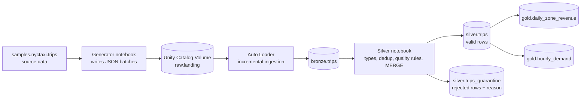
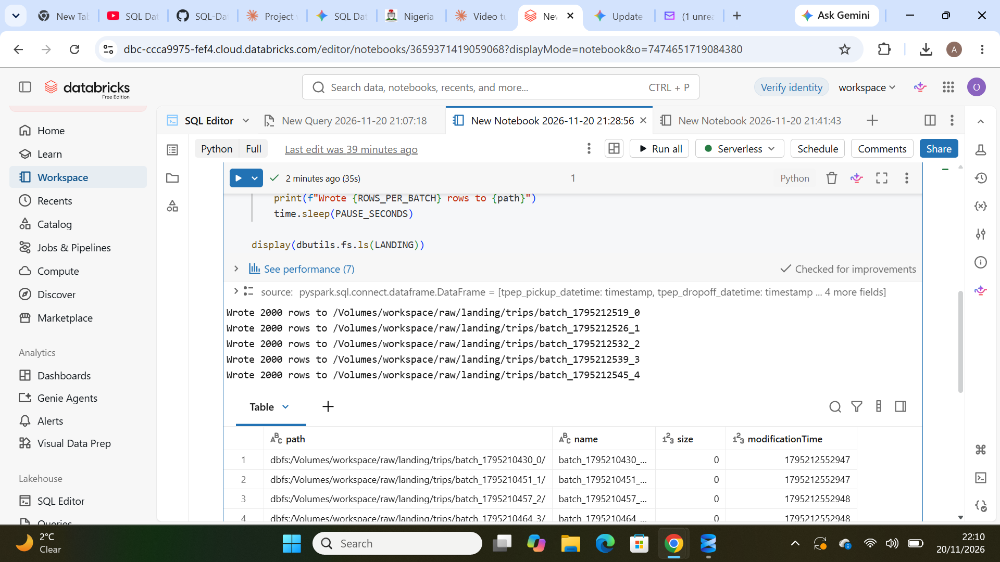
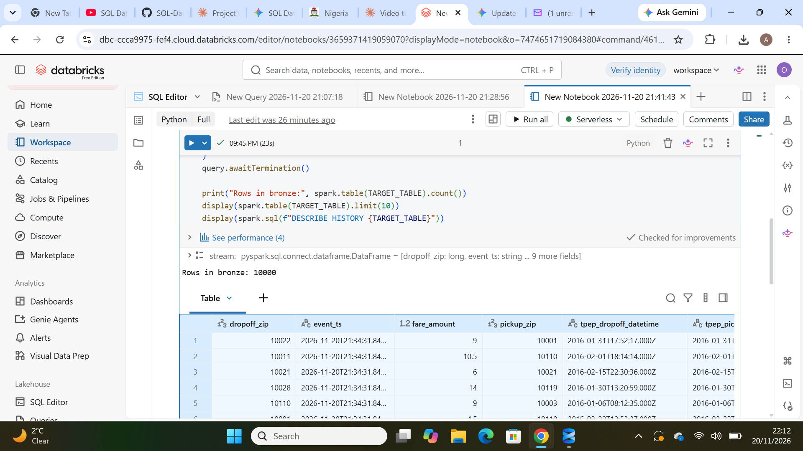
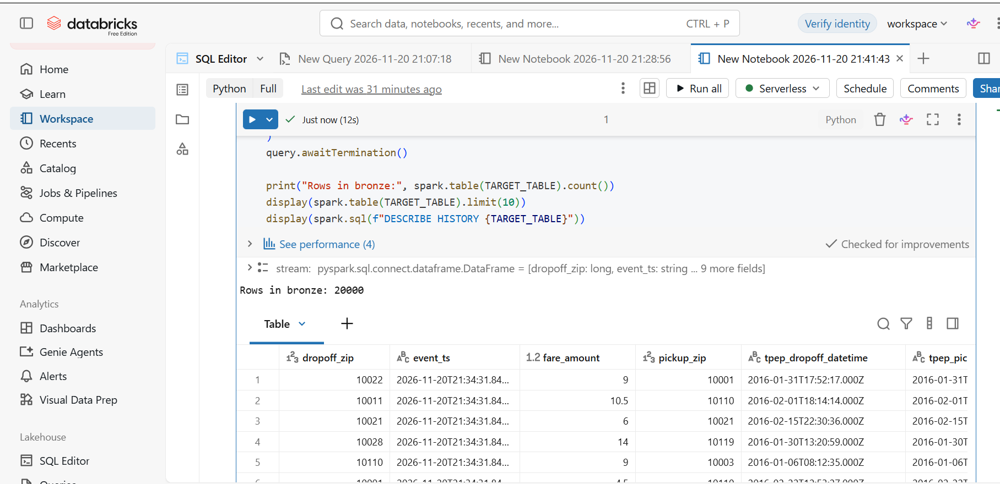
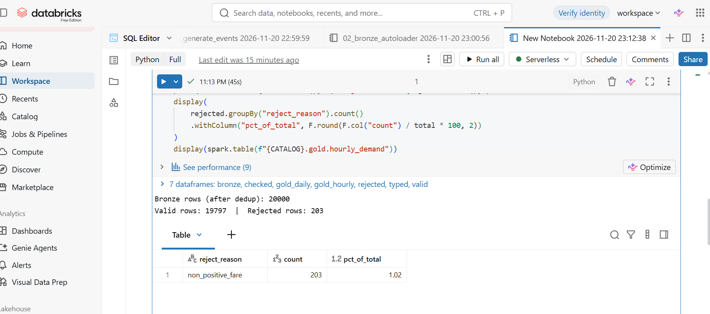
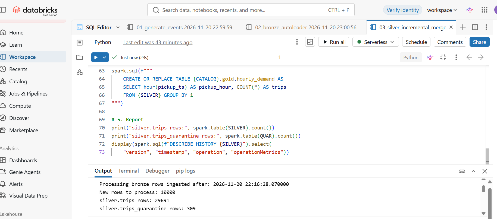
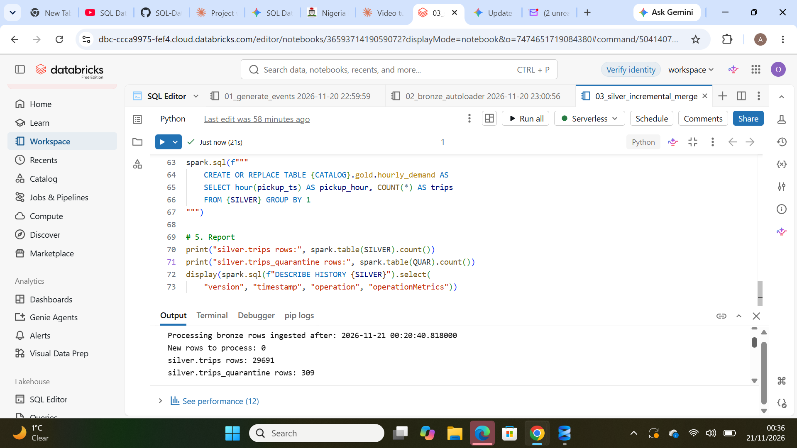
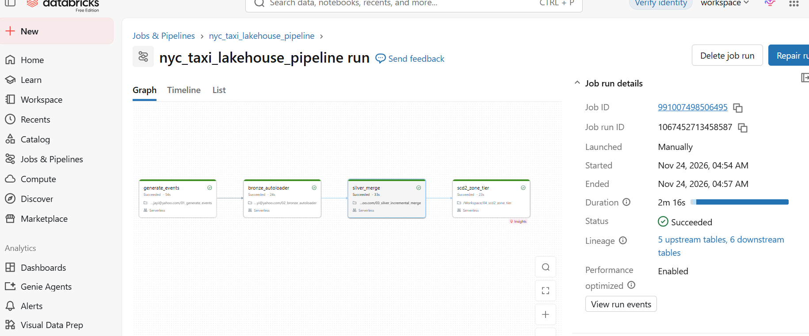
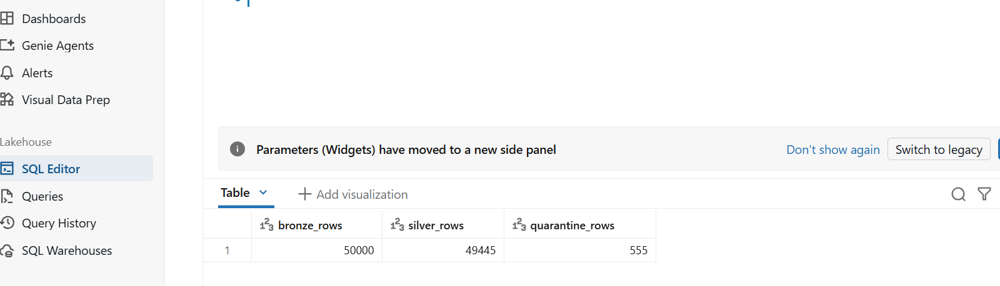

# nyc-taxi-lakehouse
Incremental data pipeline on Databricks: Auto Loader, Delta Lake, MERGE, medallion architecture, data quality quarantine

# NYC Taxi Lakehouse: Incremental Pipeline on Databricks

An end-to-end data pipeline built on Databricks (Free Edition) with Delta Lake and Unity Catalog. It ingests taxi trip files as they arrive, cleans them, quarantines bad records, and produces analytics tables. Every stage is incremental and safe to re-run.

**Built by:** *[Olayemi Ajayi]* | **Contact:** *[linkedin.com/in/olayemi-ajayi-a8a04b223/ajayiasafe@gmail.com]*

---

## The problem

Trip data arrives as files in batches. A production pipeline must:

1. Load **only new files**, never re-processing old ones.
2. Keep **bad records out** of analytics tables without losing them.
3. Be **safe to re-run** after a failure without creating duplicates.
4. Give analysts **ready-to-use tables**, not raw files.

## Architecture



This follows the **medallion architecture**:

| Layer | Table | Purpose |
|---|---|---|
| Bronze | `bronze.trips` | Raw data exactly as it arrived, plus audit columns (`_source_file`, `_ingested_at`) |
| Silver | `silver.trips` | Cleaned, correctly typed, de-duplicated, validated trips |
| Silver | `silver.trips_quarantine` | Rejected rows, each tagged with the reason it failed |
| Gold | `gold.daily_zone_revenue` | Trips, total fare and average distance per day and pickup zip |
| Gold | `gold.hourly_demand` | Trips per hour of day |

## Tech stack

Databricks (Free Edition, serverless compute), Delta Lake, Unity Catalog (catalog, schemas, Volumes), Auto Loader (`cloudFiles`), PySpark, Spark SQL.

## How it works

**1. Simulated arrival (`01_generate_events`).** Samples 2,000 trips per batch from `samples.nyctaxi.trips`, gives each a unique `trip_id`, and writes five JSON batches into a Volume. About 1% of fares are made negative on purpose, to test the quality rules. The files are simulated, so this is file-based incremental ingestion, not a live stream.

**2. Bronze ingestion (`02_bronze_autoloader`).** Auto Loader reads only files it hasn't seen before. Its checkpoint records which files are done, which gives exactly-once ingestion of files. It also infers the schema and can add new columns automatically (`addNewColumns`).

**3. Silver build (`03a_silver_gold_initial_build`).** Converts text dates to timestamps, drops duplicate `trip_id`s, and applies these rules. Failing rows go to quarantine with a reason:

| Rule | Reject reason |
|---|---|
| Missing or unparseable timestamp | `bad_timestamp` |
| Fare is zero or negative | `non_positive_fare` |
| Drop-off not after pickup | `dropoff_not_after_pickup` |
| Missing pickup zip | `missing_pickup_zip` |

**4. Incremental silver (`03b_silver_incremental_merge`).** Finds the latest `_ingested_at` already processed, reads only newer bronze rows, and uses Delta `MERGE` to upsert into silver and quarantine. Re-running changes nothing. Gold tables are then refreshed from silver.

**5. Zone demand history (`04_scd2_zone_tier`).** Classifies every pickup zip as high, medium or low demand, in thirds by trip volume. The table is a slowly changing dimension (SCD Type 2): when a zone moves to a different tier, its old row is closed with an end date (`effective_to`, `is_current = false`) and a new current row is added, so the full history is kept. Change Data Feed is enabled on the table, so every insert and update can be read with `table_changes`.

**6. Orchestration (`nyc_taxi_lakehouse_pipeline` Databricks Job).** Runs the pipeline end to end as a four-task workflow on serverless compute: `generate_events`, then `bronze_autoloader`, then `silver_merge`, then `scd2_zone_tier`. Each task depends on the one before it, so a failure stops everything downstream. Tasks retry automatically on failure, and the job is triggered manually for now to avoid unplanned compute use.

## Results

| Check | Result |
|---|---|
| Bronze after first load | 10,000 rows |
| Bronze after second batch | 20,000 rows (not 30,000, so no files were re-read) |
| Bronze after third batch | 30,000 rows |
| Quality check on first 20,000 rows | 19,797 valid, 203 rejected (**1.02%**), all `non_positive_fare` |
| Incremental MERGE after third batch | 10,000 new rows processed. Silver 29,691 + quarantine 309 = 30,000, matching bronze exactly |
| Re-run with no new data | **0** rows processed, and silver stayed at 29,691 |
| Hourly demand | Quiet in the early morning, rising through the day to a peak at 6 PM (2,000 trips) |
### Screenshots

**Simulated data arrives as files**



**Bronze: Auto Loader loads only new files (10,000 rows, then 20,000)**




**Silver: data quality rules quarantine bad rows (1.02%)**



**Incremental MERGE: only new rows are processed, and re-runs are safe**




**Orchestration: the job runs the full pipeline in order**





## Design decisions

- **Quarantine instead of delete.** Bad rows are kept with a reason, so they can be investigated or corrected and replayed.
- **MERGE instead of overwrite.** Overwriting silver every run does not scale. MERGE on `trip_id` processes only new data and is idempotent.
- **Checkpoint-based ingestion.** Progress is stored in the checkpoint, not in notebook code, so the loader behaves the same from any notebook.
- **Audit columns.** `_source_file` and `_ingested_at` make every row traceable to its file and arrival time.
- **Medallion layers.** Raw data is never modified, so silver and gold can always be rebuilt from bronze.

## Roadmap

- Orchestrate the pipeline with a multi-task Databricks Job (retries and failure alerts)
- Add Unity Catalog access controls (row and column security)
- Rebuild the pipeline with Lakeflow Spark Declarative Pipelines and expectations
- Add CI/CD with Databricks Asset Bundles and GitHub Actions

## Repository structure

```
nyc-taxi-lakehouse/
├── README.md
├── src/
│   ├── 00_setup.sql
│   ├── 01_generate_events.py
│   ├── 02_bronze_autoloader.py
│   ├── 03a_silver_gold_initial_build.py
│   ├── 03b_silver_incremental_merge.py
│   └── 04_scd2_zone_tier.py
└── docs/            (screenshots)
